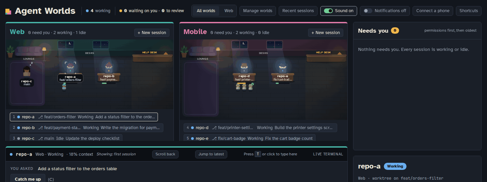
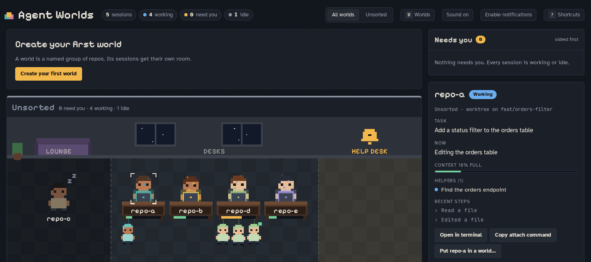
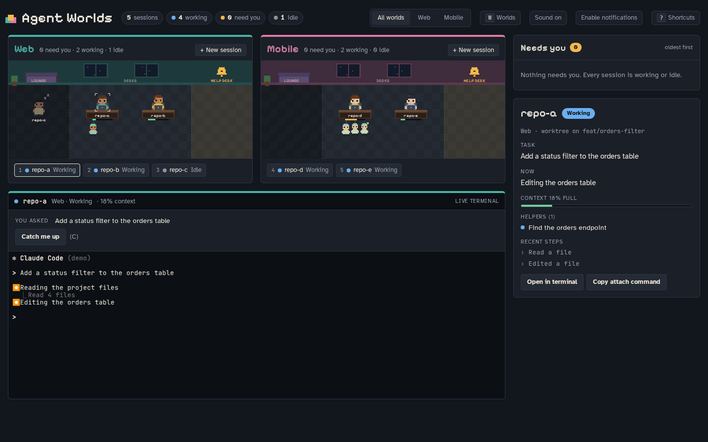
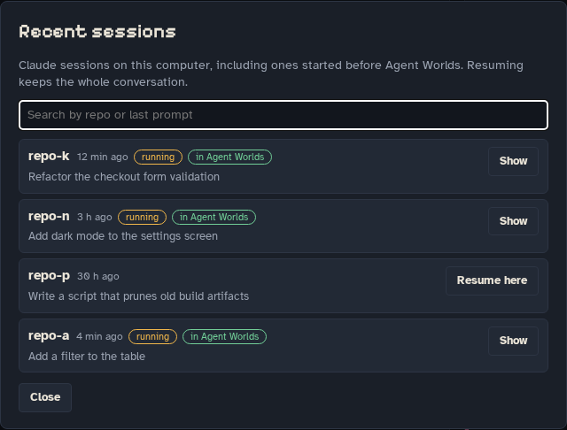
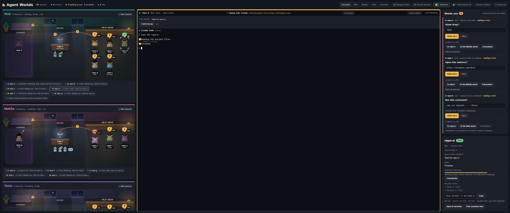
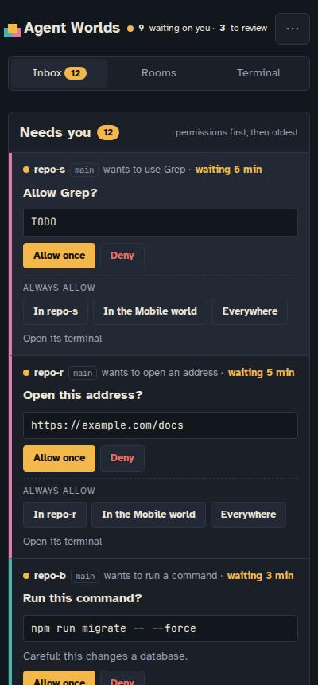
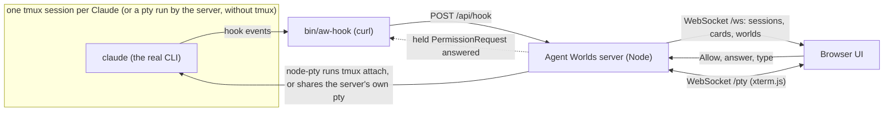
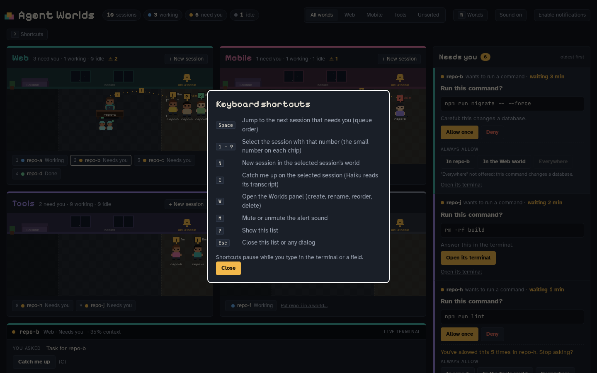

# Agent Worlds

**Run and watch many Claude Code sessions from one browser tab.** Sessions live in illustrated
rooms, everything that needs you lands in one inbox, and each session is the real `claude`
CLI in a real terminal.



<sub>All media on this page was recorded from the bundled mock server with made-up data
(`web/mock/server.mjs`), not from real sessions.</sub>

## Why

- **Attention is the bottleneck.** With five sessions running, the hard part is knowing which
  one is waiting for you. Rooms, timers and a "needs you" count make that visible at a glance.
- **Answer everything from one inbox.** Permission requests, questions, errors and finished
  turns from every session, oldest first. Allow, deny, answer or review without switching windows.
- **A real terminal underneath.** Every session is the real `claude` CLI in a real terminal, so skills,
  slash commands and your own keybindings all work. The GUI adds to the terminal, it does not replace it.

## Features

### Worlds and rooms

A **world** is a named group of folders: git repos, or any folder such as a workspace of repos (for example "Web" or "Mobile"). Each world gets a
room, and each session stands in the zone that matches what it is doing:

| Zone | Who is there |
|---|---|
| **Lounge** (left, dim) | idle sessions, resting |
| **Desks** (middle) | working sessions, with their helpers (subagents) underneath. A session that is busy without needing you sits still with a bubble: "…" while it compacts, a clock while background work (helpers, including one you sent to the background mid-run with Ctrl+B, background commands, a scheduled wake-up) runs on after its turn. Only work new that turn counts: a dev server or artifact watcher still running from an earlier turn does not keep it there. If that work never reports back, it moves to the Help desk as done after 30 minutes (or a few minutes after a scheduled wake-up was due) |
| **Help desk** (right, amber) | sessions that need you: waiting, finished or failed. A timer counts how long they have waited, and they slump after 10 and 20 minutes |

Each character wears a name tag with its project and branch; hover or select one to read both in full,
and the chips under the room list them too. Faces show the state: smiling at work, asleep when idle,
frowning on error. A busy zone widens and a quiet one gives way, so a crowded help desk keeps its
tags readable, and on a phone the tags stay at a readable size.

Characters walk between zones when their state changes. Click a character (or its chip) to select it
and type straight into its terminal; `1`-`9` select it and keep the keyboard shortcuts.

Press `W` to create, rename, recolour, reorder or delete worlds, and to pick each world's repos
with a folder browser. Nothing is fixed: a fresh install has no worlds, and sessions whose folder
is in no world sit in an **Unsorted** room. A session joins the world whose folder holds it most
closely, so `~/ws/repoX` beats `~/ws` beats `~`; a world that lists the repo itself wins. Deleting a world never stops its sessions.



### Needs-you inbox

Every session that needs something shows a card: permissions first, then oldest first. The
header counts "waiting on you" (permissions, questions) apart from "to review" (finished, error).
The list holds still while your pointer is over it, so a click never lands on a different card.

- **Permission requests**: the command, a warning for risky ones, **Allow once**, **Deny**, and
  **Always allow** for this repo, this world or everywhere. "Everywhere" is refused for shell
  commands (a command can be reworded to slip past any check) and for rules that would allow a
  whole tool; this repo and this world still work. Risky requests (pushes, database changes,
  deploys, recursive deletes, writes outside the project) also get a warning.
- **Questions**: each option is a button; multi-select and several questions work.
- **A turn that ends in a question** shows as "asking": the question and a reply box.
- **Finished turns**: a review of what changed since the session started (files +/-, the commits
  made, and anything not yet committed, listed separately), the last test result and a colourised
  diff. **Ask Claude to commit** appears only when something is uncommitted, **Open MR** only
  when there are commits; `/ship-check` is always there. New worktrees fork from the repo's
  default branch (origin/HEAD, else main/master), never from what the main checkout has open.
- **Errors**: a quick reply box to tell the session what to do next.
- **Catch-up** (on request): a short "you asked / it did / it needs" summary of any session.
- **Context and conflicts**: how full each session's context is, with `/checkpoint`,
  `/handover-save` and `/clear` buttons when it gets heavy, and a warning when two sessions
  work in the same folder, branch, shared test database or issue (a dashed line between them in
  the room, and a `!` beside each).

### Live terminal

The panel under the rooms is the session's real terminal (xterm.js attached to the session).
Press `T` or `Enter` (or click) to type into it; the panel is outlined and says "Typing into
Claude" while it has the keyboard. The catch-up box above it tells you where it stands.

Copying works from the terminal: what Claude Code or tmux copies reaches your clipboard, and
`Shift`+drag (`Option`+drag on a Mac) selects text past tmux's mouse mode and copies it on release.



Sessions you started by hand outside tmux still show up and their cards still work, but they have
no live terminal (see [Sessions started outside tmux](#sessions-started-outside-tmux)).

### Existing sessions and Resume

Agent Worlds also knows about Claude sessions you started before it, or outside it.

- **Recent sessions** (header button or `R`) lists sessions from `~/.claude/projects`, newest
  first, with the repo, your last prompt and how long ago. Search narrows the list.
- **Resume here** runs `claude --resume <id>` in a new session, in the session's original
  folder, with its full conversation. If that session is still open in another terminal, you are
  asked first; **Stop it and resume here** quits that copy (it keeps the conversation) and then
  resumes, so two copies never write to one conversation.
- Claudes running in plain terminals appear as faded **ghosts** with a dashed outline, in their
  world's lounge (or Unsorted). Each room folds them into one chip, "N other Claude sessions on
  this computer"; open it, select one, quit that terminal's Claude, then **Move into Agent
  Worlds** to take it over. Ghosts get no number key.
- **New session** and **Resume** have a **Permissions** choice. It defaults to your own Claude
  default (shown in brackets); the others are ask before every action, auto-accept edits, plan
  only and auto.
- Process detection reads `/proc`, so it is **Linux only**. Elsewhere there are no ghosts, but
  Recent sessions and Resume work.



### Terminal and browser together

With tmux installed, every session is a tmux session named `aw-<repo>-<id>`, so you can use it
from a terminal as well as the browser, at the same time, and it keeps running when Agent Worlds
restarts.

```sh
bin/agent-worlds ls        # list Agent Worlds tmux sessions
bin/agent-worlds attach    # pick one and attach (asks which when there is more than one)
```

`attach [name]` attaches the current terminal, and inside tmux it switches your client instead
of nesting. This is the way to use a terminal such as Ghostty. The panel also shows the plain
`tmux attach -t <name>` command with a copy button. The window size follows whichever client
typed last.

### Without tmux

tmux is optional. Without it, sessions started from the app run inside Agent Worlds itself: the
live terminal, replies and recent output all work, and every browser watching a session shares it.
The terminal says "Runs without tmux". Such sessions end when Agent Worlds restarts or updates
(you can resume them from Recent sessions), and you cannot open them from your own terminal.
`bin/agent-worlds new` and `attach` still need tmux.

### Sessions started outside tmux

A session you started by hand in a plain terminal (with the hooks installed) still shows up: its
state, rooms and inbox cards all work. It has no live terminal in the browser, only a note that
it is view-only; answer its cards from the inbox, or in the terminal it runs in.

### Start sessions from the app

**+ New session** in a room starts a session in one of that world's folders, optionally in a new
git worktree and with an optional first task. The task field can stay empty for a blank session.
In a folder that is not a git repo the session starts right there, with no worktree or branch option.

### Ultrawide and phone

The layout uses the whole screen. On an ultrawide monitor you get rooms, a full-height terminal
and the inbox side by side; on a phone it collapses to Inbox / Rooms / Terminal tabs so you can
answer cards one-handed.





### Connect a phone

Press **Connect a phone** in the header. Nothing is reachable from other devices until you turn it on:

- **At the office, on the same Wi-Fi** (the default route): **Allow phones** starts answering on this
  computer's network address (remembered in `listen`). Plain HTTP, so only on a network you trust.
  If the phone says "can't be reached", the computer's firewall usually blocks the port: the dialog
  detects firewalld or ufw and shows the one command to open it, until a phone gets through.
- **From anywhere, with a public link** (opt-in): set a password, then **Turn on the public link**. It
  starts a free Cloudflare quick tunnel and gives an `https://….trycloudflare.com` address. It needs
  Cloudflare's `cloudflared` program on this computer: **Install cloudflared** in the dialog downloads the
  official release into `~/.local/bin` (no account, no admin rights; or install it yourself). Anyone
  with the link reaches a login page; the password protects it, and 5 wrong tries lock logins for 15
  minutes. The link changes, and is off, after every server restart. **Turn off** closes it at once.
- **Tailscale** (private alternative): needs the Tailscale app on this computer *and* the phone.

Then scan the QR code with the phone's camera: it logs the phone in, with no token to type. Each code
works once and expires after 5 minutes. With a password set you can also just open the link and log in.

**Who signed in** lists every device that logged in (browser, IP, public link or network, how: password,
QR or token link, first and last visit) and every failed try. Behind the public link the IP is the
caller's real address as reported by Cloudflare.

### Install as an app

The web UI is a PWA: in Chrome or Edge use **Install app**, on iOS Safari **Add to Home Screen**.
Notifications (opt-in, header button) and a short sound per world tell you when something needs
you while the tab is in the background. Phones only offer installation over **https** (or on
localhost); see [Troubleshooting](#troubleshooting).

### Updating

When the code under `server/src` or `web/src` changes on disk (for example after `git pull`), the
page shows "A new version of Agent Worlds is ready" with **Update now**. It rebuilds the web app if
needed, checks the new server code loads, restarts the server and reloads the page. It needs the
server started with `bin/agent-worlds start`, and it waits while a session is waiting on a
permission prompt. Sessions in tmux keep running; sessions running without tmux end, and the page
asks first (**Update anyway**).

## Requirements

- Node.js 24 or newer (the server is TypeScript run directly by Node; there is no build step)
- git, curl
- tmux (optional, recommended): keeps sessions running across restarts and lets you open them from your own terminal
- [Claude Code](https://claude.com/claude-code) (`claude` on your PATH)
- A C/C++ toolchain for `node-pty` if no prebuilt binary matches your platform

## Quick start

From the repository folder:

```sh
(cd server && npm install)
(cd web && npm install && npm run build)
bin/agent-worlds start    # keep this running, e.g. in its own tmux window
bin/agent-worlds open     # in another shell: opens the app in your browser, already logged in
```

`open` launches your browser with the login link (it uses `xdg-open`, or `open` on macOS) and
prints the link if it finds no opener. `bin/agent-worlds url` just prints it
(`http://127.0.0.1:4317/?token=...`). The link stores the token in a cookie and redirects to the
app. Then press **`W`** to create your first world and add its repos. Put `bin/agent-worlds` on your PATH if you
like: `ln -s "$PWD/bin/agent-worlds" ~/.local/bin/`.

Click **+ New session** in a room, or from a shell:

```sh
bin/agent-worlds new <worldId> ~/code/repo-a "fix the failing login test"
```

This needs tmux. It creates a tmux session `aw-<repo>-<id>` running `claude` in that folder. Find a world's
id in `~/.config/agent-worlds/config.json`.

## Sessions you start by hand

Sessions started from the app, or with `agent-worlds new`, need nothing extra: they run
`claude --settings ~/.config/agent-worlds/hooks.json` (the server writes that file at start),
so they report to Agent Worlds without touching your Claude settings.

To also see sessions you start yourself with plain `claude`, add the hooks globally. Agent
Worlds never edits your Claude settings: print the block and merge it into the `"hooks"` of
`~/.claude/settings.json` yourself.

```sh
bin/agent-worlds hooks --print
```

Having both is fine: Claude runs an identical hook command only once, and the server also
ignores a byte-identical event that arrives twice at the same moment. Start such sessions
inside tmux if you want the terminal view.

The block wires `SessionStart`, `UserPromptSubmit`, `PreToolUse`, `PostToolUse`,
`PostToolUseFailure`, `PermissionRequest`, `Notification`, `Stop`, `StopFailure`,
`SubagentStart`, `SubagentStop` and `SessionEnd` to `bin/aw-hook`. `aw-hook` is safe to leave
installed: when the server is not running it exits silently within about a second, and
`AGENT_WORLDS_DISABLE=1` turns it off for one shell.

## How it works



- **State** comes from Claude Code hooks. `aw-hook` posts each event to the server, which keeps
  every session's state in memory and pushes changes to the browser over a websocket.
- **Permissions**: the `PermissionRequest` hook is held open until you click allow or deny in
  the browser; the server then returns the decision to Claude. Claude's own prompt is on screen
  in the terminal at the same time, so answering in either place works, whichever comes first.
  `PermissionRequest` hooks get `timeout: 3600` seconds and the server holds each request for up
  to 3540; if no browser is open, it answers at once and you get the normal terminal prompt.
- **Questions** (`AskUserQuestion`) are answered through the same held `PermissionRequest`
  (`behavior: "allow"` with `updatedInput.answers`), which keeps the terminal question usable too.
- **Typing** from the browser goes in with `tmux send-keys -l` (literal, never through a shell),
  followed by Enter. Without tmux the server writes the text to the session's pty instead.
- **Without tmux** the server starts `claude` itself in a pty and `aw-hook` sends
  `AGENT_WORLDS_PTY` so each event lands on the right session.
- **Catch-up** runs `claude -p --model haiku` on the transcript with `AGENT_WORLDS_DISABLE=1`,
  in restricted mode in an empty temp directory, at most two at a time.

## Keyboard shortcuts

Press `?` in the app for this list. Shortcuts pause while you type in the terminal or a field; the terminal header says
"Typing into Claude" and "shortcuts paused" while it has focus.

| Key | Action |
|---|---|
| `Space` | jump to the next session that needs you |
| `1` - `9` | select the session with that number (the small number on its chip) |
| `N` | new session in the selected session's world |
| `R` | open Recent sessions (resume an earlier session) |
| `C` | catch me up on the selected session |
| `W` | open the Worlds panel |
| `M` | mute or unmute the alert sound |
| `T` or `Enter` | type into the selected session's terminal |
| `Ctrl` + `]` | leave the terminal and get the shortcuts back (`Esc` still goes to Claude) |
| `?` | show the shortcuts |
| `Esc` | close the dialog or panel |



## Configuration

Settings live in `~/.config/agent-worlds/config.json` (set `AGENT_WORLDS_HOME` to use another
folder). You rarely need to edit it: worlds are managed in the app and saved there. Restart the
server after editing by hand. `bin/agent-worlds init` writes a starter file with no worlds.

| Key | Default | Meaning |
|---|---|---|
| `port` | `4317` | port to listen on |
| `host` | `"127.0.0.1"` | single address to bind; ignored when `listen` is set |
| `listen` | `["127.0.0.1"]` | addresses to bind. Add a private VPN address (for example a Tailscale `100.x.y.z`) to reach it from your phone |
| `extraHosts` | `[]` | extra `host:port` origins allowed to call the server, for example `"localhost:5190"` when running the web UI's Vite dev server |
| `userSettingsPath` | `~/.claude/settings.json` | where "Always allow: everywhere" writes its rule |
| `claudeBin` | `"claude"` | the Claude Code binary used for new sessions and catch-up summaries |
| `contextLimit` | `1000000` | context window used for the context % (usage past it, or a `[1m]` model id, counts as 1M) |
| `worlds` | `[]` | `{ "id", "name", "color", "repos": [...] }` entries, normally managed in the app. `id` is lower-case letters, digits and `-`; each repo belongs to at most one world |

Rules written by "Always allow" use Claude Code's permission syntax: "In `<repo>`" goes to
`<repo>/.claude/settings.local.json`, "In the `<world>` world" to every repo of that world,
"Everywhere" to `userSettingsPath`. Existing content is kept, and a file that is not valid JSON
is never touched.

Other environment variables: `AGENT_WORLDS_HOME` (config folder) and `AGENT_WORLDS_DISABLE=1`
(turn the hook off for one shell).

## Security

- The server binds `127.0.0.1` by default. **Do not expose it on a network**: the terminal view
  is a full shell as your user, and allowing a permission runs commands on your machine. If you
  add an address to `listen` for phone use (**Connect a phone** does this for you), prefer one only
  you can reach (a private VPN such as Tailscale). A LAN address is plain HTTP: anyone on that
  network who can watch the traffic can take the login cookie, and with it your shell.
- **Why a token on localhost?** Anyone else logged in to the same machine can reach `127.0.0.1`,
  and the terminal is a shell as you.
- Every HTTP route and both websockets require the token (cookie `aw_token` or header
  `X-AW-Token`). The login cookie lasts a year, so you only enter the token again after clearing
  cookies or changing it. The token is in `~/.config/agent-worlds/token` (mode 0600); delete it
  and restart to rotate. The PWA manifest and icons are the only files served without it.
- Requests that carry an `Origin` header, and the `Host` of every request, must be the server's
  own host:port or an `extraHosts` entry (otherwise 421 "unknown host").
- Session state is in memory only. After a restart, a session reappears on its next hook event;
  one the app started is taken back at once, at its desk if its transcript shows it mid-turn.

## Troubleshooting

- **A session does not show up.** Is the server running (`bin/agent-worlds url` prints its
  address)? Sessions you started by hand only appear if the hooks are installed
  ([above](#sessions-you-start-by-hand)); Claude Code reads its hooks when it starts, so quit
  and start `claude` again after adding them. Sessions it cannot place in a world appear under
  **Unsorted**.
- **A card says "Answer this in the terminal".** That request is no longer held by the server
  (no browser was open when it arrived, or the hold timed out). Click **Open its terminal** and
  answer Claude's own prompt.
- **A session stays in the lounge while compacting.** The compacting hooks (`PreCompact`,
  `PostCompact`) are newer than your global hooks block. Sessions started from the app pick them
  up by themselves; if you installed the hooks globally, print the block again and merge it in.
- **A new session seems stuck.** Claude may be asking to trust the folder. The session shows as
  "starting" until its first event; answer the question in its terminal panel once.
- **The terminal says the session is view-only.** You started it by hand in a terminal that is not
  tmux. Cards still work; start it in tmux (or from the app) for a live terminal.
- **No permission cards appear.** Your Claude default permission mode is `auto` or bypass, so
  Claude never asks. Pick "Ask before every action" under **Permissions** when you start a session
  to override it for that session. `acceptEdits` mode also gives no cards for file edits. Agent Worlds only
  sees what Claude asks.
- **"unknown host" (421).** The server only answers its own address. Add the `host:port` you
  are using (for example a tunnel under another name) to `extraHosts` in the config and
  restart.
- **An old link says it no longer works.** The token changed. Run `bin/agent-worlds open` on the
  machine running the server for a fresh link.
- **"Always allow: In <repo>" and worktrees.** The rule is written to the main repo's
  `.claude/settings.local.json`. Claude Code 2.1.211 or newer applies it in that repo's
  worktrees too.
- **My phone does not offer "Install app".** Browsers only offer installation over https or on
  localhost, so a plain `http://100.x.y.z:4317` address works in the browser but will not
  install. Put the server behind an https proxy on your private network (for example
  `tailscale serve`) if you want the installed app on a phone.
- **`vite dev` gets "forbidden" errors.** Add `"localhost:5190"` to `extraHosts` and restart the server.

## Development

From the repo root:

```sh
npm run install:all                  # npm ci in server/ and web/
npm test                             # server + web tests
npm run typecheck                    # tsc (server) and vue-tsc (web)
npm run build                        # type-check and build the UI into web/dist
```

Or per package:

```sh
npm --prefix server test             # server unit and HTTP tests (isolated tmux and home)
npm --prefix server run typecheck    # tsc --noEmit
npm --prefix web test                # web unit tests (vitest)
npm --prefix web run build           # type-check and build the UI into web/dist
npm --prefix web run mock            # fake server on :4322 (random state changes)
npm --prefix web run dev             # Vite on :5190, proxying to the mock
```

The mock server (`web/mock/server.mjs`) is what the media above was recorded from. Useful
switches: `MOCK_DEMO=1` (a fixed two-world scenario driven by `POST /api/demo/ask` and
`/api/demo/done`), `MOCK_DEMO=worlds` (the same sessions with no worlds yet), `MOCK_EMPTY=1`
(no worlds), `MOCK_NOTICK=1` (no random state changes) and `MOCK_ECHO=1` (plain echo terminal).

## License

MIT, see [LICENSE](LICENSE).
